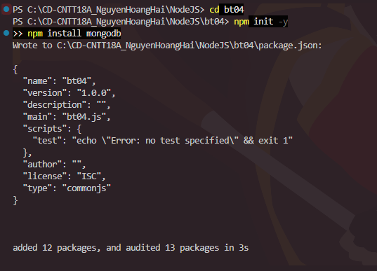
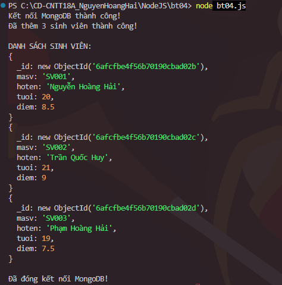
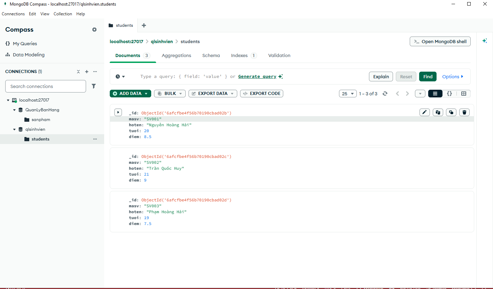

BÀI TẬP 04 - KẾT NỐI MONGODB BẰNG NODE.JS

1. Mục tiêu

Kết nối MongoDB đang chạy trên máy local.

Sử dụng database qlsinhvien.

Sử dụng collection students.

Thêm ít nhất 3 sinh viên bằng insertMany().

Hiển thị danh sách sinh viên bằng find().

Đóng kết nối MongoDB sau khi hoàn thành.

2. Công nghệ sử dụng

Node.js

MongoDB

MongoDB Node.js Driver

3. Các bước thực hiện

Bước 1: Khởi tạo dự án

bash

npm init -y

Bước 2: Cài đặt MongoDB Driver

bash

npm install mongodb

Bước 3: Khởi động MongoDB Server

Đảm bảo MongoDB đang chạy trên máy tính.

Bước 4: Chạy chương trình

bash

node bai04.js

Bước 5: Kiểm tra dữ liệu

Mở MongoDB Shell và thực hiện:

javascript

use qlsinhvien

db.students.find()

4. Kết quả thực hiện

Chương trình kết nối MongoDB thành công, thêm 3 sinh viên vào collection students, hiển thị danh 

sách sinh viên và đóng kết nối.

5. Hình ảnh minh họa

Ảnh 1: Cài đặt thư viện MongoDB

Ảnh 2: Chạy chương trình bai04.js

Ảnh 3: Kiểm tra dữ liệu trong MongoDB

6. Kết luận

Hoàn thành bài tập kết nối MongoDB bằng Node.js, sử dụng insertMany() để thêm sinh viên, find() để truy vấn dữ liệu và đóng kết nối sau khi thực hiện.